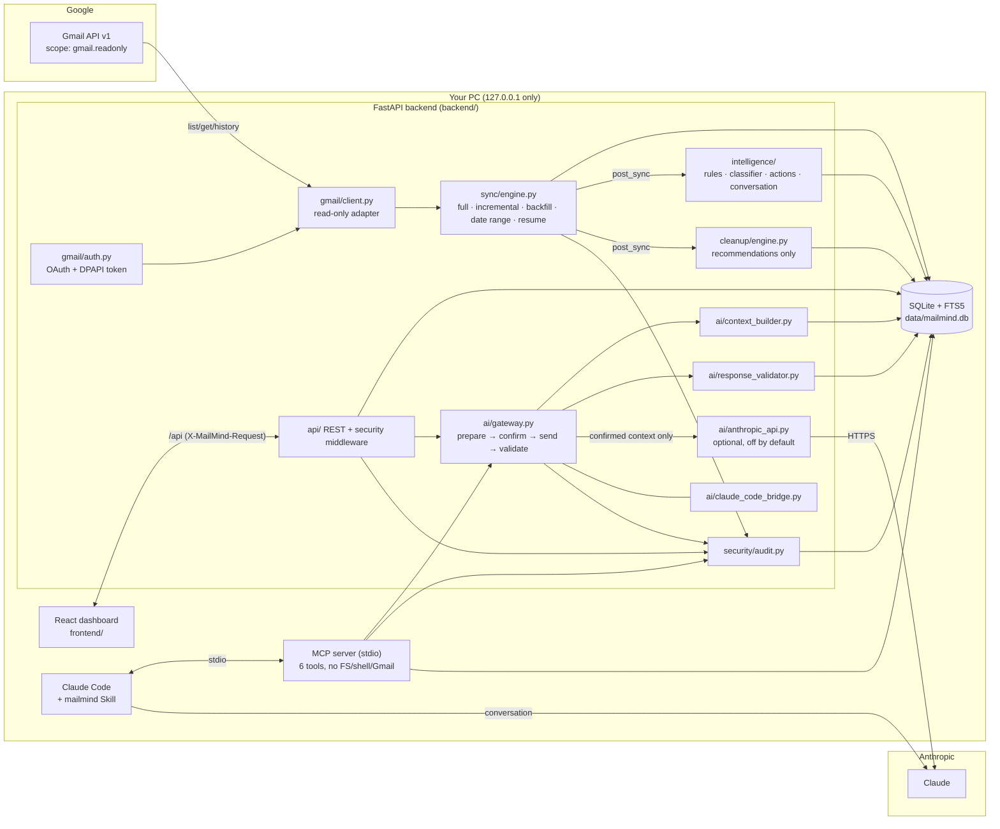
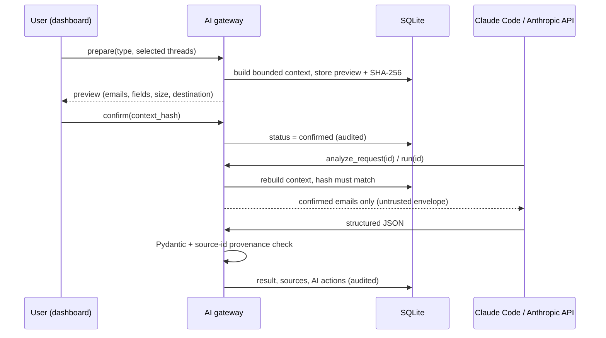

# MailMind AI architecture

MailMind is a single-user, local-first application. Everything runs on your PC, and the only
outbound connections are (a) Gmail API reads and (b) Claude analyses you explicitly request.

## Component diagram

## Layers

| # | Layer | Code | Notes |
|---|---|---|---|
| 1 | Gmail integration | `backend/gmail/` | Official Gmail API, installed-app OAuth, `gmail.readonly` only. The adapter exposes `get_profile`, `list_message_ids`, `get_message` and `list_history`, and nothing else. |
| 2 | Local synchronisation | `backend/sync/` | First sync covers the latest N days (default 30), then incremental via `history.list`, with optional backfill or a user-chosen date range (from/to). Upserts are keyed on the Gmail ID. The next page token is checkpointed after each committed page, so interrupted runs resume. Falls back to a full sync when the history ID expires. |
| 3 | Local classification | `backend/intelligence/classifier.py`, `rules.py` | Multi-label categories, work/personal area, importance 0-100, confidence 0-1 and human-readable reasons. All relationships come from user rules. |
| 4 | Conversation intelligence | `backend/intelligence/conversation.py`, `pipeline.py` | Thread state: needs_reply / awaiting_reply / action_later / informational / completed. Unread status is not an input. |
| 5 | Action tracking | `backend/intelligence/actions.py`, `actions` and `followups` tables | Request/deadline extraction (ignores quoted replies) and follow-up candidates. User status changes survive re-analysis. |
| 6 | Claude AI gateway | `backend/ai/` | Provider-independent lifecycle. Context is built only from an explicit selection. The preview hash is re-verified before sending. Responses are validated with Pydantic, and every cited source must be in the shared context. |
| 7 | MCP server | `backend/mcp_server/` | stdio. Tools: `search_emails`, `get_email`, `get_thread`, `get_actions`, `analyze_request`, `save_analysis`. |
| 8 | Cleanup engine | `backend/cleanup/engine.py` | Unsubscribe candidates, old promotions, duplicates, old notifications and large messages. It never executes anything. |
| 9 | Local database | `backend/db/`, `migrations/` | SQLite in WAL mode, foreign keys on, Alembic migrations, FTS5 index kept in sync by triggers. |
| 10 | Dashboard | `frontend/` | React + TypeScript (Vite), served by FastAPI from `frontend/dist`. |

## Data model

| Table | Purpose |
|---|---|
| `emails` | One row per Gmail message: Gmail message/thread/history IDs, headers, labels, plain-text body (optional, purgeable), content hash, attachment metadata |
| `threads` | Conversation aggregates and state |
| `senders` | Address, domain, relationship, newsletter flag, frequency (per week), unread count |
| `classifications` | 1:1 with emails: categories, importance, confidence, response state, projects, reasons, duplicate link |
| `actions` | Local or AI-extracted actions, linked to their email (and to `ai_analyses` for AI ones) |
| `followups` | needs_reply / awaiting_reply candidates with due dates |
| `cleanup_recommendations` | Suggestions with a stable fingerprint and status (pending / dismissed / acknowledged) |
| `ai_analyses` | Request, selection, exact context preview and hash, method, status, validated result |
| `ai_analysis_sources` | Gmail ID per shared email (`context`) and per extracted item (`decision`, `action`, ...) |
| `sync_state`, `sync_runs` | Checkpoints (history ID, resume token) and run history with failures |
| `audit_logs` | Who did what and when (no bodies or secrets) |
| `user_rules`, `app_settings` | User-editable rules and preferences |
| `emails_fts` | FTS5 external-content index (subject, sender, snippet, body) |

## Hybrid AI policy

* Sync → parse → classify → extract → recommend is **entirely local and deterministic**.
* Claude is used only when the user asks: in the dashboard (`prepare` → preview → `confirm`)
  or in Claude Code (the user's own prompt, with MCP tools retrieving only what that task needs).
* Low confidence is shown as a badge. It **never** creates an AI request (tested in
  `tests/test_intelligence.py::test_sync_does_not_create_ai_requests`).

## Request lifecycle (dashboard → Claude)

